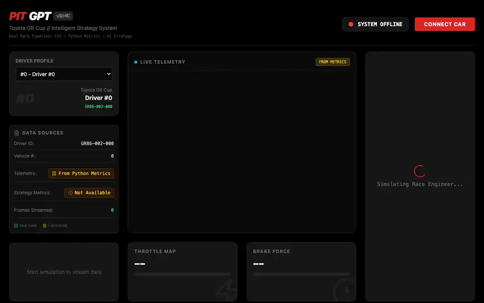
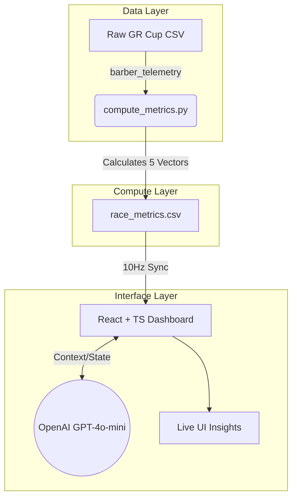
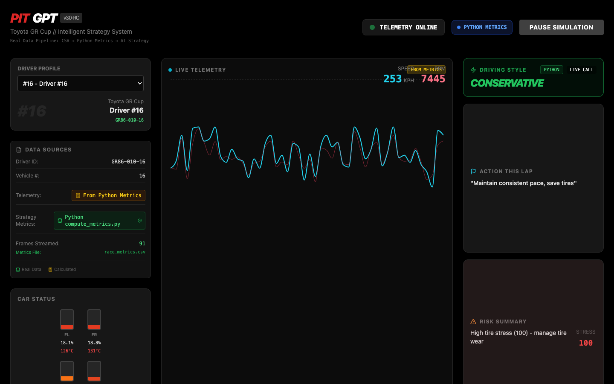
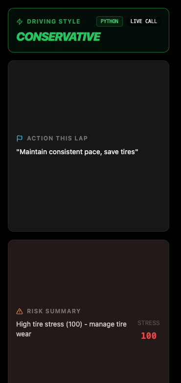
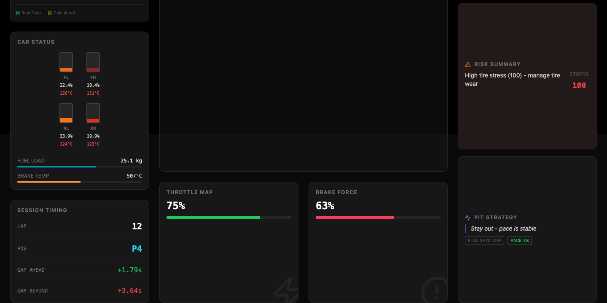

<div align="center">

# PitGPT

**An AI race engineer for the Toyota GR Cup.** It turns raw car telemetry into five strategy signals (tire stress, attack window, fuel save, overtake risk and pit window), then tells the driver what to do this lap.


<br /><br />



<sub>Recorded from the dashboard running locally with <code>npm run dev</code>, with no API key set, so the strategy cards show the rule-based fallback.</sub>

</div>

---

<p align="center">
  <a href="#from-sensor-data-to-a-pit-call">How it works</a> ·
  <a href="#the-five-strategy-vectors">Metrics</a> ·
  <a href="#run-it-locally">Run it</a> ·
  <a href="#configuration">Configuration</a> ·
  <a href="#repository-map">Repository map</a> ·
  <a href="#deploying">Deploying</a>
</p>

## From sensor data to a pit call

PitGPT simulates a **race engineer's decision-making process** in real time. Instead of only showing historical lap averages, it reads telemetry and produces strategy calls that a driver or pit crew can act on.

1. **Compute:** `compute_metrics.py` reads the Barber Motorsports Park (Race 1) telemetry and reduces each car's sensor data to five strategy metrics, written to `race_metrics.csv`. It covers about 20 drivers. The repo ships 20 rows.
2. **Stream:** the React dashboard loads those metrics and streams telemetry frames for the selected car. If the per-car Barber telemetry JSON is present it uses that; otherwise it generates frames from the Python metrics, and the **Data Sources** panel shows which one is live.
3. **Advise:** every few seconds the strategy engine sends the current state to OpenAI `gpt-4o-mini`. Without a key, or if the call fails, a rule-based fallback produces the call.



## What the dashboard shows

<table>
  <tr>
    <td width="72%" valign="top">
      
    </td>
    <td width="28%" valign="top">
      
    </td>
  </tr>
  <tr>
    <td valign="top"><sub><b>Live session.</b> The selected car's speed and RPM trace, plus a Data Sources panel that names the driver ID, the vehicle number and the file each value came from.</sub></td>
    <td valign="top"><sub><b>Strategy column.</b> Driving style, the action for this lap and a risk summary with the tire-stress score behind it.</sub></td>
  </tr>
</table>



<sub><b>Car systems and pit strategy.</b> Tire wear and temperatures, fuel load, brake temperature, session timing, throttle and brake force, and the current pit call.</sub>

> [!NOTE]
> **Data provenance is visible in the UI.** The Data Sources panel shows the exact vehicle ID (for example `GR86-022-13`) and the source file names, so you can trace each value back to the Barber dataset. When per-car raw telemetry isn't available, the panel labels the stream **From Python Metrics** instead of claiming it is real data.

## The five strategy vectors

`compute_metrics.py` reduces raw sensor data to five race vectors:

| Metric | Derived from | Signals |
| :--- | :--- | :--- |
| **Tire Stress Index** | High brake pressure + steering + lateral G spikes | Tire degradation |
| **Attack Window** | Lap time decreasing while throttle > 70% | Overtaking opportunity |
| **Fuel Conservation** | Low throttle + long braking coast | Efficiency mode |
| **Overtake Risk** | High steering + low speed gap | Collision probability |
| **Ideal Pit Window** | Tire Stress ↑ & Lap Time ↑ combined slope | Pit stop timing |

For example, the tire stress index is `TSI = (Brake_Total × 0.4) + (|Steering_Angle| × 0.3) + (|Lateral_G| × 0.3)`. Every formula, with its weights and the reasoning behind them, is in [`PitGPT_Math_Models.md`](PitGPT_Math_Models.md). Sample telemetry and a chart are in [`PitGPT_Telemetry_Snippets.csv`](PitGPT_Telemetry_Snippets.csv) and [`PitGPT_Telemetry_Charts.png`](PitGPT_Telemetry_Charts.png).

### Dataset: Toyota GR Cup, Barber Motorsports Park, Race 1

The pipeline and the Data Sources panel map to these competition files:

- `R1_barber_telemetry_data.csv`: throttle, brake, steering, accel, RPM, gear
- `23_AnalysisEnduranceWithSections_Race 1_Anonymized.CSV`: lap times and sections
- `26_Weather_Race 1_Anonymized.CSV`: weather
- `R1_barber_lap_time.csv`: timing data

> [!IMPORTANT]
> The raw `barber/` dataset is **not committed** (it is listed in `.gitignore`). To regenerate the metrics with `compute_metrics.py`, put the Toyota GR Cup data in `barber/` first. Without it, the dashboard still runs from the `race_metrics.csv` already included in the repo.

## Run it locally

**Prerequisites:** Python 3.9+, Node.js 18+, and optionally an OpenAI API key (without one, PitGPT uses its rule-based fallback).

**1. Compute the metrics (optional; needs the `barber/` dataset)**

```bash
# Install Python dependencies
pip install pandas numpy

# Compute the five strategy metrics
python3 compute_metrics.py
```

This writes `race_metrics.csv` for about 20 drivers on the grid.

**2. Launch the dashboard**

```bash
cd pitgpt---toyota-gr-cup-ai-engineer

# Install dependencies
npm install

# Copy the metrics into the app's public folder
cp ../race_metrics.csv public/

# (Optional) Set the AI key
echo "OPENAI_API_KEY=your_key_here" > .env

# Start the development server
npm run dev
```

Then open `http://localhost:3000`.

**3. Check that it works**

1. **Select a driver** from the dropdown.
2. Click **Connect Car** to start the 10 Hz telemetry stream.
3. The status should change to **`TELEMETRY ONLINE`**.
4. Check that the live charts, the five strategy vectors and the AI recommendations (which start after about 4 seconds) are all updating.

## Configuration

| Variable | Where it's read | Purpose |
| :--- | :--- | :--- |
| `OPENAI_API_KEY` | `.env` in `pitgpt---toyota-gr-cup-ai-engineer/`, loaded by `vite.config.ts` | Turns on `gpt-4o-mini` strategy calls. Optional. |
| `VITE_OPENAI_API_KEY` | Named in `DEPLOYMENT.md` for Netlify/Vercel | The same feature on hosted builds. Optional. |

> [!WARNING]
> `vite.config.ts` writes the key into the client bundle with `define`. Anyone who opens a deployed site can read it. Use a restricted key, or leave it unset and rely on the rule-based fallback, for any public deployment.

<sub>The `vite.config.ts` define maps `import.meta.env.VITE_OPENAI_API_KEY` from the `OPENAI_API_KEY` build variable. If a hosted build sets only `VITE_OPENAI_API_KEY` and the AI calls don't start, set `OPENAI_API_KEY` as well.</sub>

## Repository map

```text
PitGPT/
├── compute_metrics.py               # Strategy metric engine (5 vectors)
├── preprocess_telemetry.py          # Telemetry preprocessing
├── quick_sample_telemetry.py        # Quick telemetry sampling
├── generate_chart_image.py          # Builds PitGPT_Telemetry_Charts.png
├── race_metrics.csv                 # Compiled metrics payload
├── PitGPT_Math_Models.md            # Formulas and derivations
├── DEPLOYMENT.md                    # Netlify / Vercel guide
├── SUBMISSION_ANSWERS.md            # Submission answers and license compliance
├── barber/                          # Raw Toyota GR Cup data (gitignored, not committed)
└── pitgpt---toyota-gr-cup-ai-engineer/
    ├── App.tsx                      # Dashboard, streaming loop, telemetry fallback
    ├── components/
    │   ├── CarStatus.tsx
    │   ├── DataSourceInfo.tsx       # Provenance / verification panel
    │   ├── StrategyCard.tsx
    │   └── TelemetryChart.tsx
    ├── services/
    │   ├── raceMetricsService.ts
    │   ├── openaiService.ts         # gpt-4o-mini + rule-based fallback
    │   ├── realTelemetryService.ts  # Loads per-car Barber telemetry when present
    │   └── mockTelemetry.ts
    └── public/race_metrics.csv
```

## Deploying

The app builds to static files (`npm run build` → `dist/`), and `netlify.toml` files are included. For Netlify (drag-and-drop, GitHub import or CLI) and Vercel, see [`DEPLOYMENT.md`](DEPLOYMENT.md). Netlify build settings when importing from GitHub:

- **Base directory:** `pitgpt---toyota-gr-cup-ai-engineer`
- **Build command:** `npm install && npm run build`
- **Publish directory:** `pitgpt---toyota-gr-cup-ai-engineer/dist`

## Built with

- **UI:** React 19, TypeScript 5, Vite 6, TailwindCSS, Lucide React
- **Data visualization:** Recharts 3.5
- **Data science:** pandas, NumPy

All original race strategy algorithms, metric computation and UI components are original work for this submission. See [`SUBMISSION_ANSWERS.md`](SUBMISSION_ANSWERS.md) for full license compliance details.

## License

The project is distributed under the **MIT License**.

<sub>No standalone <code>LICENSE</code> file is committed yet.</sub>

---

<div align="center">

<i>"Data without interpretation is just noise. The ultimate race engineer doesn't just read the telemetry; they predict the future."</i>

<b>Built for the Toyota GR Cup.</b>

<br /><br />


</div>
